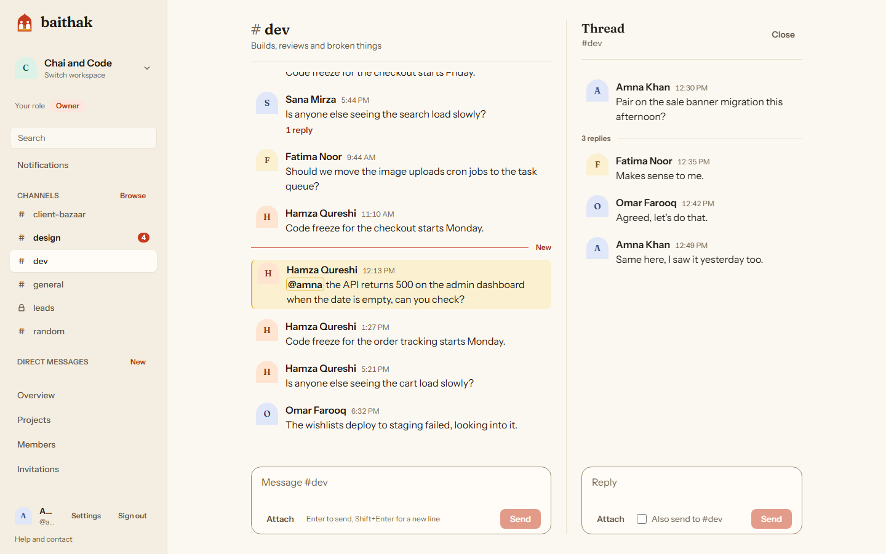
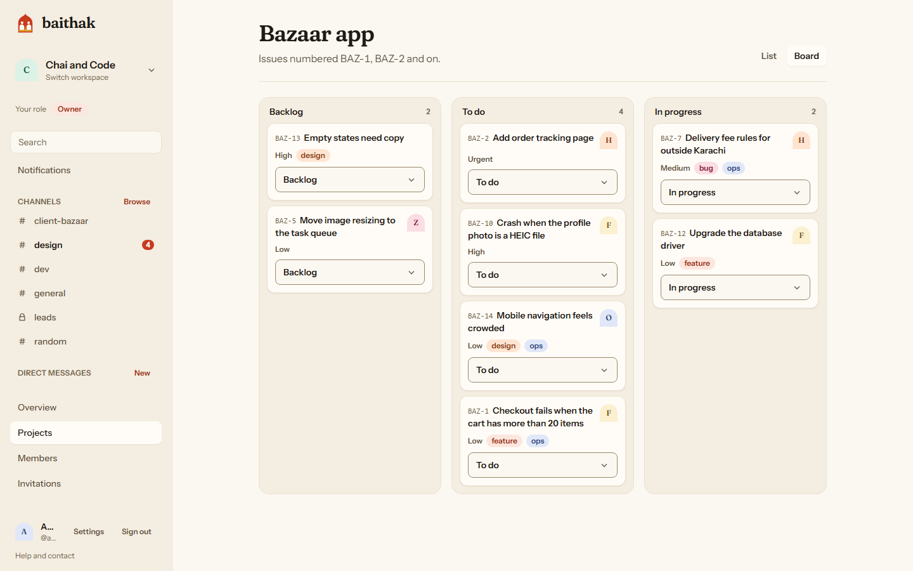
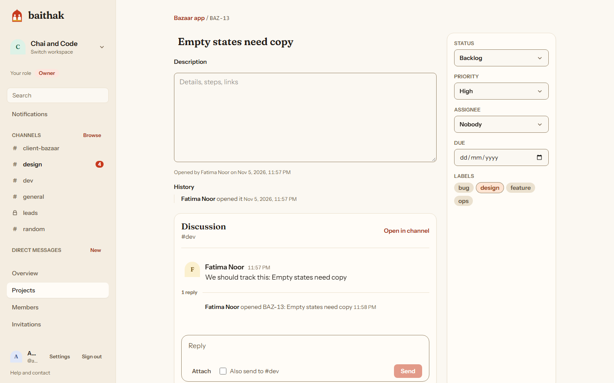
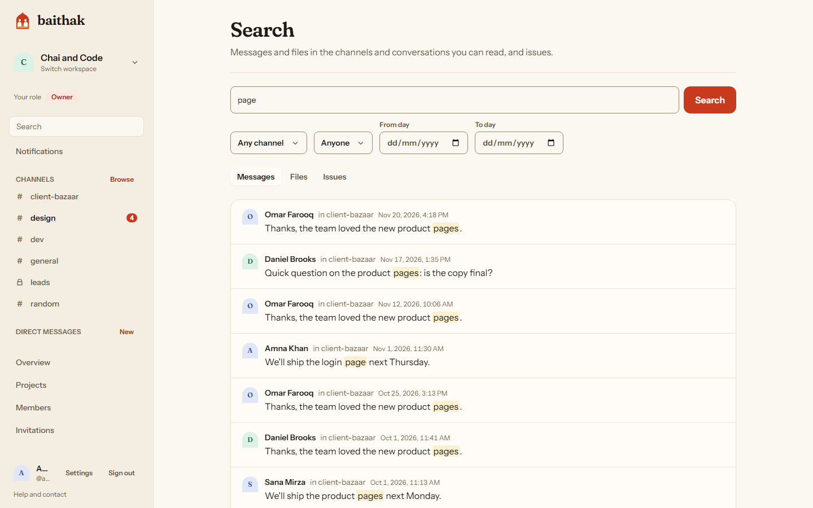
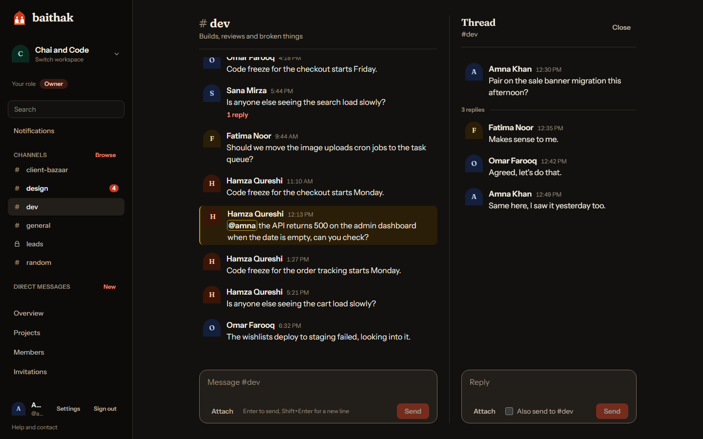

# Baithak

**Team chat and issue tracking in one place, in real time.**

Baithak (بیٹھک, the room where people sit together and talk) is for small teams that keep their
conversations in one app and their work in another, and lose the link between the two. A workspace
has channels, threads and direct messages that update live, and a small issue tracker where every
issue can start from a message and keep its discussion in a thread. GitHub pull request events
arrive in the channel that follows the repository. The interface is in English.

> Status: pre-release (`v0.6.0`). Chat, issues and integrations work; the last milestone,
> docs and launch at `baithak.ahmershah.dev`, is under way. See
> [docs/roadmap.md](docs/roadmap.md) and [docs/status.md](docs/status.md).



## What it does

- **Workspaces and channels.** Public and private channels, members and roles (owner, admin,
  member, guest), invitations by email, channel topics and an audit log.
- **Messages.** Live messages over WebSockets, threads, direct and group messages, mentions,
  reactions, edits and deletes, typing and online status, and unread counts that stay right
  across devices.
- **Files and search.** File and image uploads with previews, and full-text search over messages,
  files and issues, limited to what the person can see.
- **Issues.** Issues with labels, assignees, priorities and due dates, a board per project, and an
  issue created from any message with its discussion kept in a thread.
- **Integrations.** GitHub webhooks posting pull request and issue events into a channel, and
  incoming webhooks for other tools, with a delivery log and retries.
- **Notifications.** In-app and email notifications for mentions, direct messages and assigned
  issues, with quiet hours.

| | |
|---|---|
|  |  |
| The board: drag a card to change its status | An issue opened from a message, its thread as the discussion |
|  |  |
| Search, limited to what you can read | Light and dark themes |

## Stack

| Part | Tools |
|---|---|
| API and real time | Python 3.12, Django 5.2, Django REST Framework, drf-spectacular, Django Channels |
| Jobs | Celery (email, previews, webhooks, search indexing) |
| Data | MySQL 8.4 (InnoDB, FULLTEXT search), Redis (channel layer, presence, queue, cache) |
| Web | React, TypeScript (strict), Vite, Tailwind CSS, TanStack Query |
| Quality | pytest, pytest-asyncio, factory_boy, Vitest, Playwright, Ruff, mypy, ESLint, Prettier, GitHub Actions, CodeQL |
| Run | Docker Compose |

## Run it locally

You need Docker with Compose and Node 22.12 or later. [uv](https://docs.astral.sh/uv/) is only
needed to run the backend checks on your machine.

```sh
npm install
npm run dev
```

`npm run dev` starts MySQL, Redis, the backend (migrations run on start) and a Celery worker in
Docker, waits until they are healthy, then starts the web app at <http://localhost:5173>. Vite
proxies `/api`, `/ws`, `/admin` and `/health` to the backend at <http://localhost:8000>.
`npm run stop` stops the containers. Compose has local defaults for every setting; copy
`.env.example` to `.env` only to change one. Email is printed to the worker log
(`npm run logs`) unless `RESEND_API_KEY` is set in `.env`.

### Demo data

To see it lived in, seed two invented teams with about four months of conversations, threads
and issues (it takes a few minutes):

```sh
docker compose exec backend python manage.py seed_demo --password "pick-a-password"
```

Then sign in at <http://localhost:5173> as `amna@chai-and-code.example` (a software studio)
or `ayesha@monsoon-press.example` (a newsroom) with that password. Run it again with
`--reset` to start over. Everyone in it is made up, and they never get email.

### Screenshots

The pictures in this README come from the demo data. To take them again, with the dev
stack and `npm run dev` running:

```sh
cd frontend
npm run screenshots
```

Backend checks run against the MySQL from Compose (never SQLite):

```sh
cd backend
uv sync
uv run pytest
uv run ruff check . && uv run ruff format --check .
uv run mypy .
```

Web app checks:

```sh
cd frontend
npm run typecheck && npm run lint && npm run format:check
npm test
npm run contrast
```

## Why it exists

The hard parts of a chat app are not the message box: they are messages that reach every open tab
in order, unread counts that agree on a phone and a laptop, a reconnect that loses nothing, and
search that never shows a message from a channel you can't open. Baithak is built around those
rules, with tests for each.

## Documentation

- [docs/roadmap.md](docs/roadmap.md): milestones M1 to M7 and what "done" means
- [docs/design.md](docs/design.md): colors, themes and type
- [docs/architecture.md](docs/architecture.md): parts, data model, real-time design and decisions
- [docs/status.md](docs/status.md): current state, updated every session
- [CONTRIBUTING.md](CONTRIBUTING.md) and [SECURITY.md](SECURITY.md)

## Related

- [HolidayOps](https://github.com/ahmershahdev/holidayops): business-day calendars for countries
  and companies.
- [MarketClock](https://github.com/ahmershahdev/marketclock): trading days and settlement dates
  for stock exchanges.
- [OfflineShelf](https://github.com/ahmershahdev/offlineshelf): Wikipedia reading lists for
  offline use.
- [Karobar ERP](https://github.com/ahmershahdev/karobar-erp): stock, sales, accounts and payroll
  for small businesses.

## License

[MIT](LICENSE).
